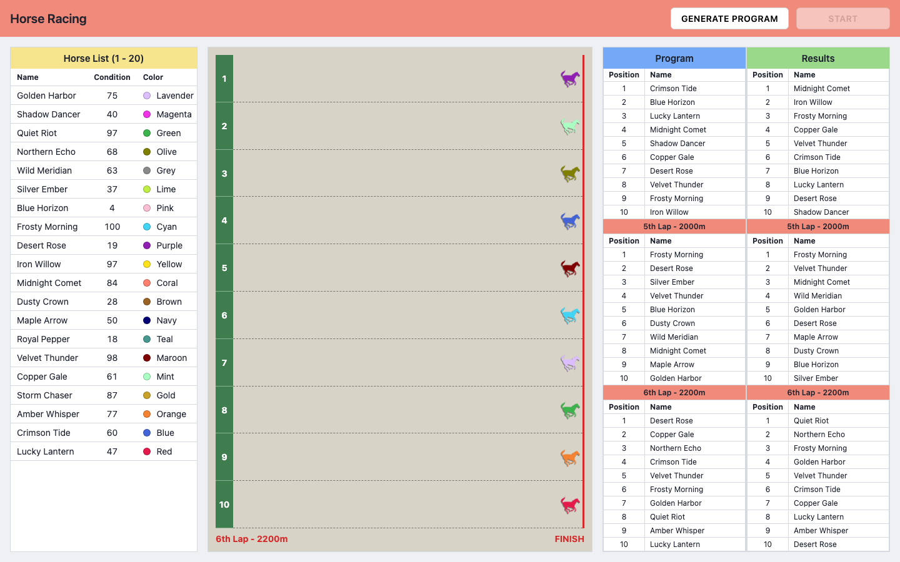

# Horse Racing

[](https://github.com/rabiaaydmr/horse-racing-game/actions/workflows/ci.yml)

An interactive horse racing game built with **Vue 3**, **Pinia** and **TypeScript**.

**Live demo:** https://rabiaaydmr.github.io/horse-racing-game/
(add `?speed=10` to the address to watch a whole program in a few seconds)



- 20 horses, each with a unique colour and a condition score between 1 and 100
- **Generate Program** draws 6 rounds (1200 m → 2200 m), 10 random horses per round
- **Start / Pause / Resume** runs the rounds one at a time with animated horses
- Results appear round by round as each race ends

## Getting started

Requires Node 22.18+ or 24.12+.

```sh
npm install
npm run dev        # http://localhost:5173
```

Tip: `http://localhost:5173/?speed=10` runs the simulation ten times faster.

| Command | What it does |
| --- | --- |
| `npm run dev` | Development server |
| `npm run build` | Type-check and production build |
| `npm run test:unit` | Unit and component tests (Vitest) |
| `npm run test:e2e` | End-to-end and visual tests (Playwright; first run `npx playwright install chromium`) |
| `npm run lint` / `npm run format` | Oxlint + ESLint / Prettier |

## Architecture

The code is split into layers, each of which only knows about the ones below it:

```
components/   What the user sees. Render state, emit events. No game rules.
composables/  Reusable stateful logic tied to the component lifecycle (the animation loop).
stores/       Pinia. The single source of truth and the state machine of the game.
services/     Game rules as pure functions: no Vue, no store, no timers.
utils/        Generic helpers (random, formatting).
constants/    Every number of the game in one place.
types/        Shared domain types.
```

```
src/
├── types/race.ts               Horse, Round, RoundResult, Runner, RaceStatus
├── constants/race.ts           Horse count, distances, simulation tuning, names, colours
├── utils/                      random (shuffle, sample, seeded source), format, runtimeConfig
├── services/
│   ├── horseFactory.ts         createHorses()
│   ├── scheduleFactory.ts      createSchedule()
│   └── raceEngine.ts           createRunners(), advanceRunners(), rankRunners() …
├── stores/
│   ├── horses.ts               The stable
│   └── race.ts                 Program, live positions, results, status, tick()
├── composables/
│   ├── useRaceLoop.ts          requestAnimationFrame → race.tick()
│   └── useScrollToChild.ts
└── components/
    ├── AppHeader.vue           Buttons (props in, events out)
    ├── BasePanel.vue           Titled, scrollable box (slot)
    ├── HorseList.vue
    ├── RaceTrack.vue → TrackLane.vue → HorseIcon.vue
    ├── ProgramPanel.vue ┐
    └── ResultsPanel.vue ┴→ RoundTable.vue
```

### Key decisions

**Game rules live outside Vue.** `services/` contains plain functions that take data and
return new data. They can be tested without mounting anything, and the simulation could be
replaced (e.g. by results coming from a server) without touching a component.

**The store does not own a timer.** Time only advances when `race.tick(ms)` is called.
In the browser `useRaceLoop` calls it on every animation frame; in tests a loop calls it
thousands of times in a few milliseconds. Pause is therefore just "stop calling tick", and a
complete six-round program can be unit-tested deterministically without fake timers.

**An explicit state machine.** `idle → ready → running ⇄ paused → finished`. Every action
checks the current status, so impossible transitions (starting without a program, ticking
while paused) are no-ops rather than bugs.

**Randomness is injected.** Every function that needs chance accepts a `RandomSource`
(defaulting to `Math.random`). Tests pass a seeded generator; visual tests seed the whole page.

**Two kinds of components.** Presentational ones (`AppHeader`, `HorseList`, `RoundTable`,
`TrackLane`, `HorseIcon`, `BasePanel`) only use props, events and slots and are reusable
anywhere. Container ones (`RaceTrack`, `ProgramPanel`, `ResultsPanel`, `App`) read the stores
and feed the presentational ones.

**Two stores.** `horses` (what exists) and `race` (what is happening). The race store reads the
horses store, never the other way round.

### How a race is simulated

Per frame, each horse still running moves `speed × dt` metres, where

```
speed = baseSpeed × conditionFactor × form × jitter
```

- `conditionFactor` scales from 0.75 (condition 1) to 1.0 (condition 100)
- `form` is drawn once per horse per round (±8 %): a good or a bad day
- `jitter` changes every frame (±30 %), which produces overtaking

So a fitter horse wins more often, but not always. When a horse crosses the line inside a
frame, its exact finishing time is interpolated, so the ranking does not depend on frame rate.
All tuning values are in `constants/race.ts`.

## Tests

- **Unit** (`src/**/__tests__`, `*.spec.ts`): helpers, factories, the race engine, the race
  store (including a full program) and a component test for `AppHeader`.
- **E2E** (`e2e/race.spec.ts`): generate, start, sequential results, pause/resume, regenerate.
- **Visual** (`e2e/visual.spec.ts`): screenshot comparison of three states with a seeded
  `Math.random`. Reference images are per platform; regenerate with
  `npx playwright test visual --update-snapshots`.

Every push runs lint, unit tests, the production build and the E2E tests on GitHub Actions
(`.github/workflows/ci.yml`); when they pass on `main`, the game is deployed to GitHub Pages.
The visual tests run locally only, because their reference screenshots are recorded on macOS
and fonts render slightly differently on the Linux runners.

## Assumptions

- The brief mentions both "1 to 20 horses" and "a total of 20 horses"; the game always creates
  20, as each round needs 10 of them.
- Horses are created once when the page loads. **Generate Program** creates a new program for
  the same horses and clears earlier results; it can be used at any time, also mid-race.
- Distances are simulated (a 1200 m round takes roughly 8 seconds), not real time.
- The layout targets desktop screens, like the reference design.

## How it was built

I built this project together with an AI coding assistant (Claude). I used it to discuss the
architecture, write code and tests, and explain Vue and Pinia concepts I was less familiar with.
I reviewed the code, made the decisions on the open points (such as the number of horses), and
went through each part to understand how it works.
